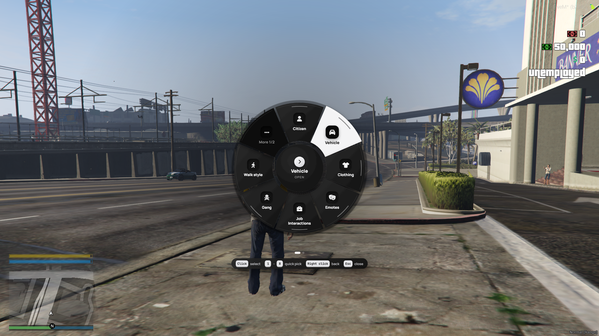
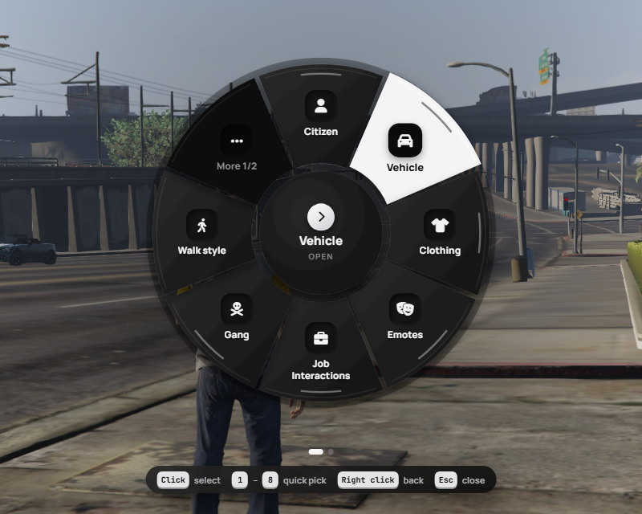
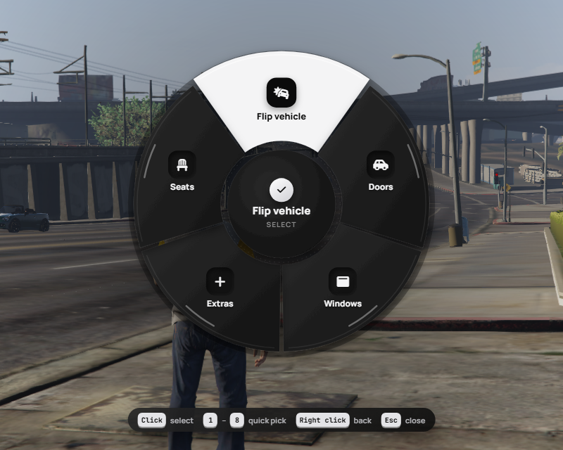
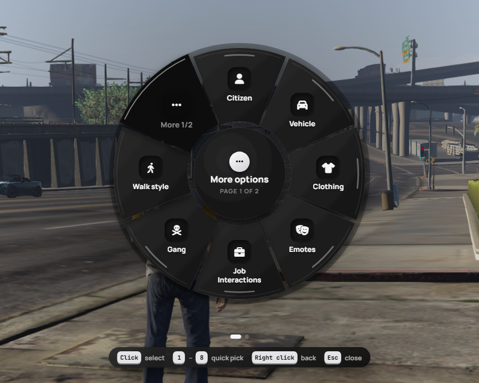
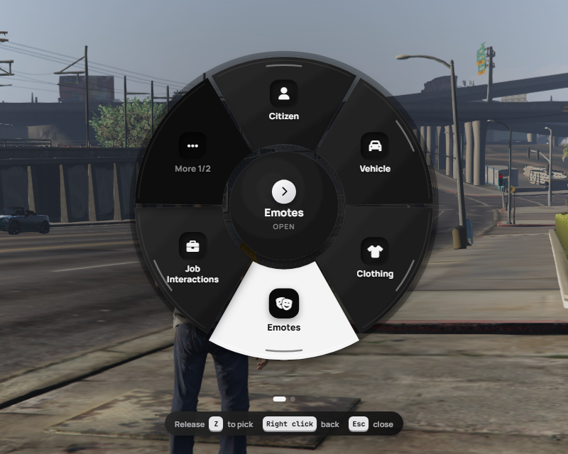

# qbx_radialmenu — Project07 edition

A drop-in rework of [Qbox's `qbx_radialmenu`](https://github.com/Qbox-project/qbx_radialmenu) with its **own black & white claymorphism radial UI**.
ox_lib is **not modified** — the menu has its own engine with the same API, so every existing item, sub menu and export keeps working.



## Previews

| Main menu | Sub menu |
| --- | --- |
|  |  |
| **Pages ("More" slot)** | **Hold-to-open mode** |
|  |  |

## Features
- Custom NUI ring (HTML / CSS / JS, no frameworks): icons + labels, hover highlight, centre shows what you are pointing at
- Sub menus with **Back** in the centre (or right click), re-highlights the item you came from
- Automatic **pages** when there are more items than fit (`perPage`), with a "More" slot and page dots
- Mouse, **1–9 quick pick**, scroll wheel, `Enter`, `Backspace` / right click back, `Esc` close
- Optional **hold-to-open** (release the key over an item to pick it)
- Scales with resolution (720p → 4K), soft hover / select sounds, reduced-motion friendly
- FontAwesome 6 icons (`'car'`, `'fa-solid fa-car'`, `{'fas','car'}`) or image URLs
- **Same API as ox_lib** inside this resource (`lib.addRadialItem`, `lib.registerRadial`, `lib.hideRadial`, …), plus exports for other resources
- ox_lib's own radial is switched off through its normal `disableRadial` export while this runs (and back on when it stops)
- Optional extra entries for other resources without editing them (e.g. `scully_emotemenu`)

## Install
1. Remove the original `qbx_radialmenu` and put this folder in its place.
2. Requires `ox_lib`, `qbx_core`.
3. Restart the server. Default key: **Z** (players can rebind it in *Settings → Key Bindings → FiveM*).

## Config (`config/client.lua`)
```lua
radial = {
    key = 'Z',           -- default key
    holdToOpen = false,  -- hold the key, release over an item to pick it
    perPage = 8,         -- items per ring before a "More" slot appears (4-10)
    scale = 1.0,         -- ring size (0.7-1.4)
    sounds = true,       -- tick on hover / select
    accent = '#f4f4f5',  -- highlight colour
    showHints = true,    -- key hints under the ring
},
integrations = {
    emotes = true,       -- scully_emotemenu: open menu, cancel emote, reset walk / face
},
```
Everything else (menu items, job / gang items, vehicle doors, windows, extras, seats) is the original Qbox config.

## API for other resources
Same arguments as the ox_lib functions:
```lua
exports.qbx_radialmenu:addRadialItem({ id = 'my_item', label = 'Hello', icon = 'hand', onSelect = function() print('hi') end })
exports.qbx_radialmenu:registerRadial({ id = 'my_menu', items = { ... } })
exports.qbx_radialmenu:removeRadialItem('my_item')
exports.qbx_radialmenu:hideRadial()
exports.qbx_radialmenu:disableRadial(true)
exports.qbx_radialmenu:showRadialMenu('my_menu')
exports.qbx_radialmenu:isOpen()
```
The original qb style exports still work: `exports['qb-radialmenu']:AddOption(data, id)` / `RemoveOption(id)`
(and `exports.qbx_radialmenu:AddOption` / `RemoveOption`).

> Resources that call `lib.addRadialItem` themselves register into **ox_lib's** radial, which is off while this runs.
> Point them at `exports.qbx_radialmenu:addRadialItem` instead (same arguments), or add them under `integrations`.

## Browser preview
Serve `web/` (for example `python -m http.server`) and open `index.html` — `?menu=vehicle`, `?hover=1`, `?hold`, `?per=6`.

## Credits
- **[Qbox Project](https://github.com/Qbox-project)** — original [`qbx_radialmenu`](https://github.com/Qbox-project/qbx_radialmenu) (config, menu items, vehicle / job / gang logic)
- **[Overextended](https://github.com/overextended)** — [`ox_lib`](https://github.com/overextended/ox_lib); the radial engine here follows ox_lib's radial behaviour and API
- **[Font Awesome](https://fontawesome.com)** — icons
- Custom radial UI and engine — **Project07** ([@PehesaraNimnad](https://github.com/PehesaraNimnad))

## License
GPL-3.0, same as the original `qbx_radialmenu` — see [LICENSE](LICENSE).
